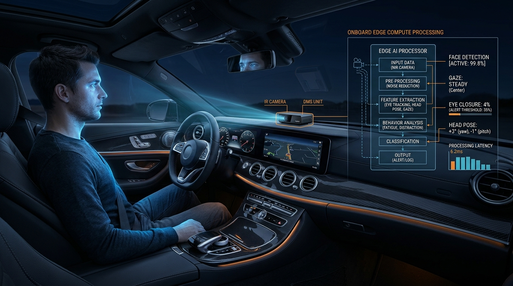
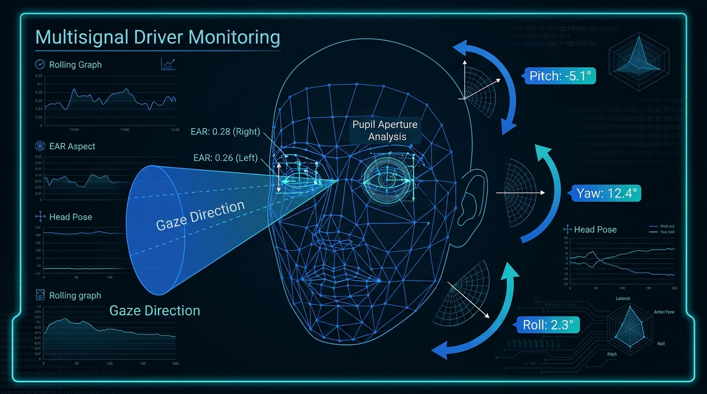
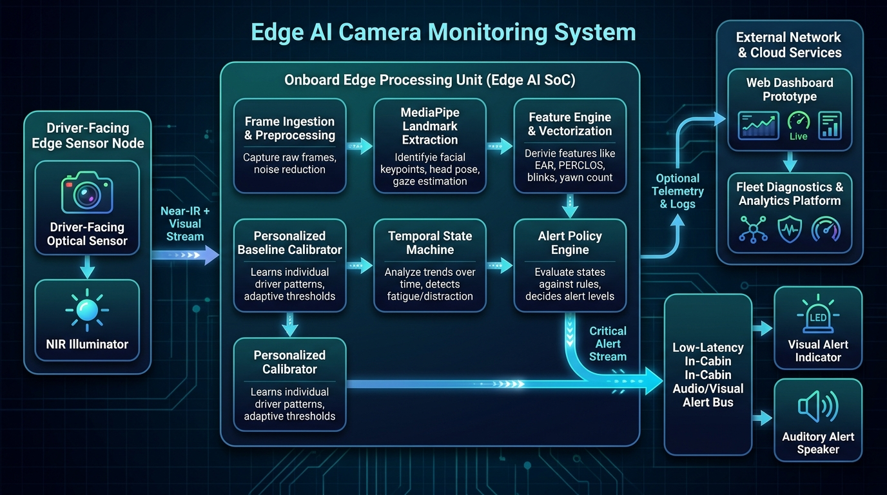
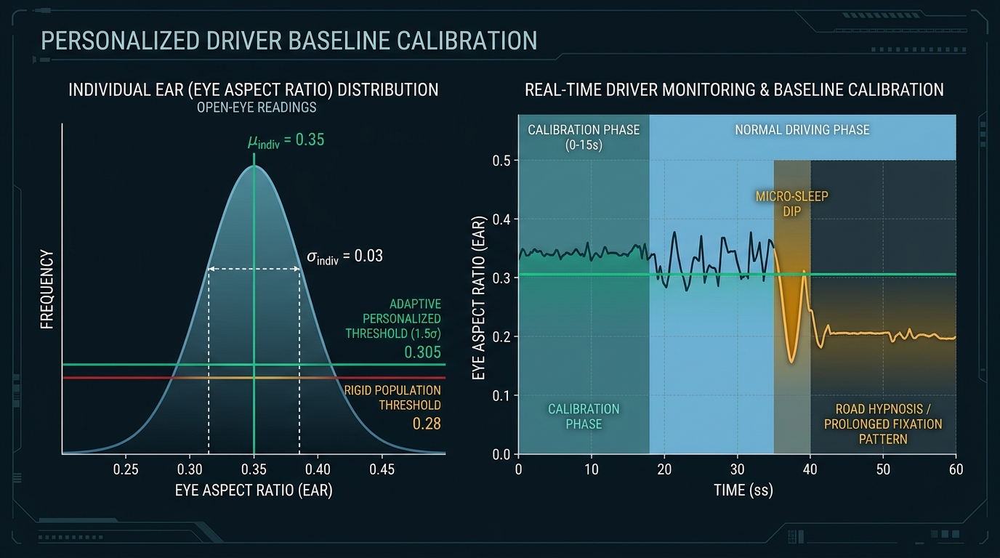
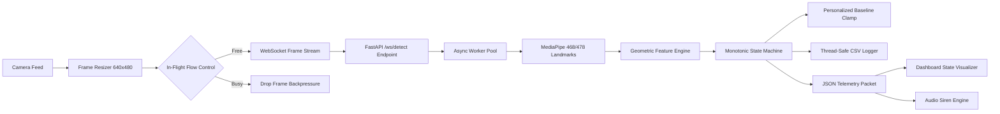
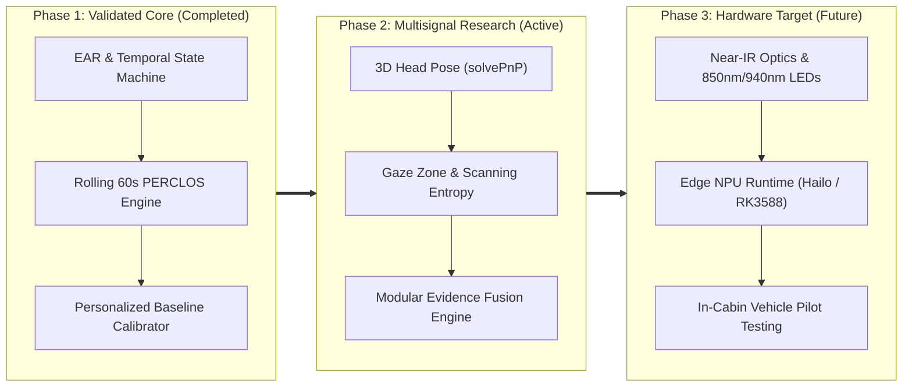

# AntiRHys — Intelligent Driver Drowsiness & Road Hypnosis Monitoring

[](https://fastapi.tiangolo.com/)
[](https://reactjs.org/)
[](https://vitejs.dev/)
[](https://opencv.org/)
[](https://developers.google.com/mediapipe)
[](https://pytest.org/)

**AntiRHys** is a computer-vision research system investigating observable physiological and behavioral cues associated with **driver drowsiness**, **micro-sleeps**, and **road hypnosis (highway hypnosis)**.

The project currently provides an interactive, responsive full-stack demonstration prototype that streams live video frames from a browser to a high-performance Python FastAPI engine over WebSockets, computes geometric eye metrics (Eye Aspect Ratio and rolling PERCLOS) via MediaPipe Face Mesh, and evaluates temporal alertness using an elapsed-time monotonic state machine.

---

> [!CAUTION]
> ### ⚠️ Critical Safety & Scientific Integrity Disclaimer
> **AntiRHys is an engineering research prototype and educational software application. It is NOT an approved automotive safety device, medical diagnostic instrument, or certified Driver Monitoring System (DMS).**
>
> Computer-vision proxies (such as Eye Aspect Ratio, gaze fixation, or blink duration) cannot definitively determine driver alertness, cognitive vigilance, drowsiness, or road hypnosis under real-world conditions. Factors such as facial morphology, eyeglasses, sunlight glare, nighttime illumination, and road vibration significantly confound optical measurements. **Never rely on this application to maintain safety while operating any motor vehicle.**

---

## Table of Contents
1. [Project Status](#1-project-status)
2. [Problem Statement & Motivation](#2-problem-statement--motivation)
3. [Long-Term Product Vision](#3-long-term-product-vision)
4. [Web Prototype vs. Dedicated Product](#4-web-prototype-vs-dedicated-product)
5. [Feature Status Matrix](#5-feature-status-matrix)
6. [Visual System Illustrations](#6-visual-system-illustrations)
7. [System Architecture](#7-system-architecture)
8. [Technology Stack](#8-technology-stack)
9. [Data Flow Pipeline](#9-data-flow-pipeline)
10. [Ocular Mathematics: EAR Formula](#10-ocular-mathematics-ear-formula)
11. [Ocular Mathematics: PERCLOS Operational Definition](#11-ocular-mathematics-perclos-operational-definition)
12. [Multisignal Research: Gaze, Head Pose & Pupils](#12-multisignal-research-gaze-head-pose--pupils)
13. [Personalized Driver Baselines & Privacy](#13-personalized-driver-baselines--privacy)
14. [Mobile Web Compatibility](#14-mobile-web-compatibility)
15. [Installation & Prerequisites](#15-installation--prerequisites)
16. [Backend Setup & Execution](#16-backend-setup--execution)
17. [Frontend Setup & Execution](#17-frontend-setup--execution)
18. [Environment Variables & Configuration](#18-environment-variables--configuration)
19. [Testing, Linting & Build Verification](#19-testing-linting--build-verification)
20. [Empirical Benchmarking & Latency Profiles](#20-empirical-benchmarking--latency-profiles)
21. [Security & Privacy Guardrails](#21-security--privacy-guardrails)
22. [Known Limitations & Confounders](#22-known-limitations--confounders)
23. [Product Roadmap](#23-product-roadmap)
24. [Contribution Guidelines](#24-contribution-guidelines)
25. [Credits & License](#25-credits--license)

---

## 1. Project Status

AntiRHys is an active **research prototype and demonstration harness**.

- **Detection Engine:** Implemented with verified mathematical Eye Aspect Ratio (EAR), rolling 60-second Percentage of Eye Closure (PERCLOS), blink dynamic tracking, and an independent monotonic temporal state machine.
- **Verification Level:** Evaluated through 93 deterministic automated tests and simulated driver behavioral benchmarks. It is **not yet validated on in-vehicle naturalistic driving cohorts**.
- **Interface:** Responsive web dashboard (desktop, tablet, and smartphone web browsers) connected to a local or remote FastAPI WebSocket service.

---

## 2. Problem Statement & Motivation

Driver fatigue, micro-sleep episodes, and cognitive dissociation contribute to thousands of highway fatalities annually. Two distinct phenomena impair driver vigilance:

1. **Acute Drowsiness & Sleep Debt:** Gradual eyelid drooping, prolonged closures ($\ge 1.5\text{s}$), and progressive fatigue leading to sudden micro-sleeps.
2. **Road Hypnosis (Highway Hypnosis):** A trance-like psychological state induced by monotonous highway driving. Crucially, in road hypnosis, **the driver's eyes remain open**, but their visual scanning freezes (staring straight ahead), saccadic exploration collapses, and cognitive response time degrades drastically.

Standard consumer webcam solutions that only check whether eyes are open or closed fail to detect road hypnosis. AntiRHys is structured to explore multisignal sensor fusion (combining ocular dynamics, gaze-zone transition entropy, and head pose stability) to identify subtle cognitive vigilance lapses before accidents occur.

---

## 3. Long-Term Product Vision

The long-term objective of AntiRHys is a **dedicated, privacy-preserving, camera-based driver-monitoring hardware system** deployed inside the vehicle cabin.


*Figure 1: Conceptual illustration of the intended dedicated driver-facing camera hardware unit mounted inside a vehicle cabin.*

### Key Commercial Hardware Tenets:
- **Dedicated Driver-Facing Sensor:** Near-Infrared (NIR, 850nm/940nm) global-shutter sensor mounted on the steering column or instrument cluster, eliminating daylight glare and darkness failures.
- **Onboard Edge AI Processing:** Compact Neural Processing Unit (NPU) or automotive SoC (e.g., Hailo-8, Rockchip RK3588, or Jetson Orin Nano) running quantized neural networks locally without cloud dependencies.
- **Immediate In-Cabin Alert Bus:** Direct GPIO or vehicle CAN bus integration triggering directional LED indicators and a piezo auditory warning ($85\text{ dBA}$) within $< 150\text{ ms}$ of acute danger.
- **Air-Gapped Privacy:** Zero continuous video streaming or cloud storage. Biometric data never leaves the onboard volatile memory.

---

## 4. Web Prototype vs. Dedicated Product

To avoid confusion, the role of the current software is explicitly distinguished from the future embedded product:

| Dimension | Current Web Application Prototype | Future Dedicated Automotive Product |
| :--- | :--- | :--- |
| **Primary Purpose** | Research, demonstration, algorithm testing, and UI evaluation. | Commercial, real-time, in-vehicle life safety alerting. |
| **Compute Location** | Client browser + Python FastAPI server process. | Embedded edge SoC/NPU inside camera enclosure. |
| **Optical Sensor** | Consumer RGB webcam or smartphone camera. | Calibrated Near-IR (NIR) sensor with active pulsed LED illumination. |
| **Environmental Lighting** | Requires good ambient visible room lighting. | Operates in total darkness, direct sunlight, and through polarized sunglasses. |
| **Alert Delivery** | Browser Web Audio API siren synthesis. | Hardwired vehicle audio buzzer and HUD alert strobe. |
| **Network Requirement** | Requires local or remote WebSocket connection. | **100% Autonomous & Offline;** zero network dependency. |
| **User Role** | Interactive researcher/evaluator viewing live metrics. | Unobtrusive passive background monitoring while driving. |

---

## 5. Feature Status Matrix

| Feature / Component | Category | Source Verification | Status |
| :--- | :--- | :--- | :--- |
| **Eye Aspect Ratio (EAR)** | Perception | [`backend/detector.py`](backend/detector.py#L313-L342) | **Implemented & Verified** |
| **Monotonic Temporal State Machine** | Core Logic | [`backend/detector.py`](backend/detector.py#L400-L870) | **Implemented & Verified** |
| **Rolling 60s PERCLOS Integration** | Perception | [`backend/detector.py`](backend/detector.py#L152-L306) | **Implemented & Verified** |
| **Blink Counter & Duration Filter** | Perception | [`backend/detector.py`](backend/detector.py#L810-L822) | **Implemented & Verified** |
| **Tracking Loss vs. Alert Isolation** | Safety Logic | [`backend/detector.py`](backend/detector.py#L674-L735) | **Implemented & Verified** |
| **FastAPI WebSocket Streaming Server** | Transport | [`backend/main.py`](backend/main.py#L247-L525) | **Implemented & Verified** |
| **Thread-Safe Session CSV Logger** | Diagnostics | [`backend/session_logger.py`](backend/session_logger.py) | **Implemented & Verified** |
| **Responsive Mobile / Tablet Web UI** | Frontend | [`frontend/src/index.css`](frontend/src/index.css) | **Implemented & Verified** |
| **Touch Controls & Camera Track Safety** | Mobile | [`frontend/src/components/CameraStream.tsx`](frontend/src/components/CameraStream.tsx) | **Implemented & Verified** |
| **Personalized Baseline Calibrator** | Personalization | [`backend/baseline_calibrator.py`](backend/baseline_calibrator.py) | **Implemented & Verified** |
| **Pipeline Performance Profiler** | Benchmarking | [`backend/benchmark_pipeline.py`](backend/benchmark_pipeline.py) | **Implemented & Verified** |
| **Real-Vehicle Naturalistic Validation** | Validation | Requires naturalistic road cohort | **Not Yet Validated in Vehicles** |
| **3D Head Pose Estimation (PnP)** | Perception / Research | [`backend/head_pose.py`](backend/head_pose.py) | **Implemented & Verified (Observational)** |
| **Gaze Vector & Zone Entropy** | Research | [`docs/road_hypnosis_research.md`](docs/road_hypnosis_research.md) | **Planned Research** |
| **Multisignal Evidence Fusion** | Research | [`docs/road_hypnosis_research.md`](docs/road_hypnosis_research.md) | **Planned Research** |
| **Infrared Pupillometry (PUI)** | Sensor Research | Blocked on NIR global-shutter hardware | **Hardware Blocked** |
| **Embedded NPU Standalone Runtime** | Hardware Target | Requires embedded Linux / RTOS board | **Future Hardware Integration** |

---

## 6. Visual System Illustrations

The AntiRHys documentation includes four architectural and conceptual diagrams stored in `docs/images/`:

````carousel

<!-- slide -->

<!-- slide -->

<!-- slide -->

````

1. **`antirhys-product-vision.png`**: Dedicated driver-facing camera hardware concept inside a vehicle cabin.
2. **`multisignal-detection.png`**: Technical diagram illustrating 3D facial landmarks mesh, Eye Aspect Ratio vectors, gaze direction cone, head pose angles (pitch, yaw, roll), and pupil aperture analysis.
3. **`antirhys-architecture.png`**: Block diagram showing edge sensor node, onboard edge processing unit, local alert bus, and optional telemetry dashboard.
4. **`personalized-monitoring.png`**: Conceptual driver baseline calibration curve showing individual open-eye EAR Gaussian distribution and adaptive vs. rigid population thresholds.

---

## 7. System Architecture

AntiRHys enforces strict architectural boundaries separating presentation, transport, feature derivation, temporal reasoning, and alerting:


*Figure 2: Modular block diagram of the edge processing engine and alert pipeline.*

### Subsystem Boundaries:
- **Boundary 1 (Ingestion):** Frame capture and raster resolution clamping ($640 \times 480$) to eliminate excessive memory and network bandwidth.
- **Boundary 2 (Perception):** MediaPipe Face Mesh landmark extraction running isolated instances per session to prevent cross-session state corruption.
- **Boundary 3 (Ocular Features):** Mathematical coordinate geometry computing EAR, blink dynamics, and rolling window PERCLOS.
- **Boundary 4 (Personalization):** Gated baseline calibrator adapting closure thresholds relative to individual ocular distributions.
- **Boundary 5 (Temporal Reasoning):** Elapsed monotonic clock state machine enforcing hysteresis and recovery gates.
- **Boundary 6 (Alert Bus & Diagnostics):** Multi-level alert dispatch and sanitized audit logging.

Detailed architectural specifications and migration pathways are documented in [docs/product_architecture.md](docs/product_architecture.md).

---

## 8. Technology Stack

- **Frontend Application:**
  - **Framework:** React 19 + TypeScript + Vite.
  - **Styling:** Modern dark-mode Vanilla CSS with responsive grid tokens and mobile touch targets ($\ge 44\text{px}$).
  - **Audio Engine:** Browser Web Audio API synthesizer generating alternating frequency alerts.
- **Backend Service:**
  - **Framework:** Python 3.11 with FastAPI and Uvicorn.
  - **Computer Vision:** OpenCV (`cv2`) and Google MediaPipe (`mediapipe==0.10.14`).
  - **Concurrency:** Asyncio with non-blocking thread-pool offloading (`asyncio.to_thread`) for image decoding and model inference.
  - **Testing:** Pytest with AnyIO.

---

## 9. Data Flow Pipeline



1. **Client Capture:** Captures video stream; downscales raster canvas to max 640px; regulates transmission at 10 FPS.
2. **Backpressure Guard:** Verifies `isFrameInFlight` and `ws.bufferedAmount < 64KB` before transmitting to prevent queue latency buildup.
3. **Backend Parsing:** Enforces 5MB size limits, validates JSON schemas, decodes base64 JPEG buffers into OpenCV BGR arrays.
4. **Landmark Inference:** Processes 468/478 3D facial mesh coordinates in non-blocking worker threads.
5. **Feature Calculation:** Computes instantaneous EAR for both eyes; validates minimum eye width ($> 1\text{ px}$).
6. **Temporal Reasoning:** Tracks continuous closure durations against calibrated thresholds; updates 60s rolling PERCLOS deque; counts blinks; executes recovery hysteresis ($1.0\text{s}$ open eyes to clear alarm).
7. **Logging & Dispatch:** Writes sanitized scalar records to CSV; sends low-bandwidth JSON status packet back to client.

---

## 10. Ocular Mathematics: EAR Formula

The **Eye Aspect Ratio (EAR)** is a dimensionless scalar measuring vertical eyelid aperture relative to horizontal eye span.

AntiRHys utilizes the 6 standard MediaPipe landmark indices per eye:
- **Left Eye:** Lateral corner `p1=33`, Upper lid `p2=160`, `p3=158`, Medial corner `p4=133`, Lower lid `p5=153`, `p6=144`.
- **Right Eye:** Lateral corner `p1=362`, Upper lid `p2=385`, `p3=387`, Medial corner `p4=263`, Lower lid `p5=373`, `p6=380`.

$$\text{EAR} = \frac{\|p_2 - p_6\|_2 + \|p_3 - p_5\|_2}{2 \cdot \|p_1 - p_4\|_2}$$

Where $\|\cdot\|_2$ denotes the Euclidean 2D distance between pixel landmark coordinates.

- **Open Eyes:** Typically yields $\text{EAR} \approx 0.28\text{ to }0.38$.
- **Closed Eyes / Blinks:** Drops sharply to $\text{EAR} < 0.15$.
- **AntiRHys Default Threshold:** Provisional engineering baseline set at $\tau = 0.25$, requiring $\ge 1.5\text{ seconds}$ of sustained closure to trigger an acute drowsiness alarm.

---

## 11. Ocular Mathematics: PERCLOS Operational Definition

**PERCLOS (Percentage of Eye Closure)** measures the proportion of time that a driver's eyes remain closed over a rolling observation window (typically 60 seconds). It is widely regarded in transportation physiology as one of the most reliable indicators of slow-onset fatigue.

### Operational Formula:

$$\text{PERCLOS} = \frac{\sum_{i \in \mathcal{W}_{\text{valid}}} \mathbb{I}(\text{EAR}_i < \tau_{\text{closure}}) \cdot \Delta t_i}{\sum_{i \in \mathcal{W}_{\text{valid}}} \Delta t_i}$$

### Implementation Guardrails in `PerclosCalculator`:
1. **Rolling Time-Based Deque:** Observation entries older than $60.0\text{ seconds}$ are automatically purged using monotonic timestamps.
2. **Valid Observation Threshold:** At least $20.0\text{ seconds}$ of valid face-tracking observations must be accumulated within the 60s window before the metric is reported as `VALID`.
3. **Status Differentiation:**
   - `CALCULATING`: Monitoring active, but accumulated observation time is $< 20.0\text{s}$.
   - `VALID`: Accumulated observation time $\ge 20.0\text{s}$; PERCLOS value is mathematically sound.
   - `INSUFFICIENT_DATA`: Gaps from tracking loss or network dropouts left $< 20.0\text{s}$ valid data.
   - `UNAVAILABLE`: Face is currently untracked.
4. **Anti-Inflation Rule:** Periods of face occlusion or tracking loss are **strictly excluded** from both the numerator and denominator. Missing tracking time never falsely inflates or deflates PERCLOS.

---

## 12. Multisignal Research: Gaze, Head Pose & Pupils


*Figure 3: Candidate sensory cues for comprehensive driver state monitoring.*

The research roadmap expands detection beyond binary eye closure into a multi-modal feature fusion model:

1. **3D Head Pose Orientation (`backend/head_pose.py` — Implemented & Verified):**
   - **Anthropometric Model:** Utilizes 6 canonical 3D facial landmarks derived from the anthropometric face model (Nose Tip `[1]`, Chin `[152]`, Left Eye Outer Corner `[263]`, Right Eye Outer Corner `[33]`, Left Mouth Corner `[291]`, Right Mouth Corner `[61]`).
   - **PnP Geometry & Decomposition:** Computes rigid rotation vector $\mathbf{r}$ and translation $\mathbf{t}$ via OpenCV `solvePnP` (Iterative Levenberg-Marquardt) using derived pinhole intrinsics ($f_x = f_y = W, c_x = W/2, c_y = H/2$). Rotational matrices are decomposed into Tait-Bryan Euler angles via `RQDecomp3x3`.
   - **Explicit Angle Conventions & Coordinate Signs:**
     - **Pitch ($^\circ$):** Rotation about the transverse $X$-axis. **Negative ($< 0^\circ$)** indicates downward tilt / chin-drop toward chest (nodding). **Positive ($> 0^\circ$)** indicates looking upward.
     - **Yaw ($^\circ$):** Rotation about the vertical $Y$-axis. **Negative ($< 0^\circ$)** indicates turning to driver right (camera left). **Positive ($> 0^\circ$)** indicates turning to driver left (camera right).
     - **Roll ($^\circ$):** Rotation about the optical $Z$-axis. **Negative ($< 0^\circ$)** indicates counter-clockwise tilt (left ear toward shoulder). **Positive ($> 0^\circ$)** indicates clockwise tilt.
   - **Pre-Validation & Reprojection Gating:** Inputs are validated for finite values and a minimum bounding-box spread ($> 15\text{ px}$) to eliminate collinear/degenerate solver crashes. Back-projected 3D points are compared against observed 2D landmarks: if Root-Mean-Square Error (RMSE) exceeds $15.0\text{ px}$, the estimate is gated as `HIGH_REPROJECTION_ERROR` with `head_pose_valid = False`.
   - **Strict Signal Isolation Guarantee:** Head pose is maintained as an **independent observational signal**. Under no circumstances does looking away, turning, or lowering the head trigger a drowsiness alarm or override EAR/PERCLOS metrics. Prolonged closure triggers alarms independently regardless of head orientation.
   - **Observational Limitations:** Provisional thresholds (e.g., Pitch $< -20^\circ$ for nodding, $|Yaw| > 25^\circ$ for distraction) serve solely as observational telemetry. Head pose alone does NOT detect road hypnosis or prove driver inattention.
2. **Visual Scanning & Gaze Entropy (Road Hypnosis Indicator — Planned Research):**
   - Measures transition entropy across windshield and mirror zones.
   - Prolonged fixation on the forward center zone ($> 90\%$ over 30s) with low scanpath entropy signals possible highway hypnosis staring.
3. **Pupillometry Dynamics (PUI — Hardware Blocked):**
   - **Hardware Prerequisite:** Requires active Near-Infrared (NIR) illumination and global-shutter optics. Prohibited on consumer webcams due to ambient sunlight noise and pupil reflections.

Comprehensive research evaluations and confounder analyses are detailed in [docs/road_hypnosis_research.md](docs/road_hypnosis_research.md).

---

## 13. Personalized Driver Baselines & Privacy


*Figure 4: Personalized driver baseline calibration distribution and safety bounds.*

Human eye geometry exhibits wide natural variation. Applying a rigid population threshold (e.g., fixed $\text{EAR} = 0.25$) risks constant false alarms for drivers with naturally narrow palpebral fissures, or missed detections for drivers with wide open eyes.

### Ethical & Privacy Guardrails (`backend/baseline_calibrator.py`):
- **No Demographic Proxies:** AntiRHys rejects using race, ethnicity, age, or gender categories as proxies for eye geometry. Individual ocular distribution is measured directly.
- **Active Calibration Window:** Measures 10–15 seconds of attentive, open-eyed driving to compute empirical median, mean, standard deviation, and 10th/90th percentiles.
- **Quality & Drowsiness Gating:** Requires $\ge 80\%$ face tracking stability; immediately rejects calibration if prolonged closures or micro-sleeps occur during the calibration window.
- **Safety Clamping Envelope:** The personalized threshold is calculated as $\text{median}(\text{EAR}) \times 0.70$, but is strictly clamped:
  $$0.18 \le \tau_{\text{closure}} \le 0.32$$
  This prevents adapting thresholds into dangerous zones where true drowsiness would be normalized.
- **Zero Video Retention:** Calibration profiles store only anonymous scalar statistics (e.g. `mean: 0.34`, `std: 0.025`). No raw facial imagery or landmark vectors are ever written to disk.

---

## 14. Mobile Web Compatibility

The web dashboard is fully optimized for smartphones and tablets:

- **Responsive Viewports:** Adaptive CSS grid dynamically reorganizes from multi-column desktop layouts to single-column phone interfaces ($< 768\text{px}$) and ultra-compact landscape views ($< 520\text{px}$ height).
- **Front Camera Selection:** Explicitly requests front-facing selfie optics via `{ facingMode: { ideal: 'user' } }`.
- **Client-Side Frame Downscaling:** Mobile high-resolution camera streams (1080p, 4K) are automatically clamped on an offscreen raster canvas to a maximum width of 640px. This prevents battery drain, mobile CPU thermal throttling, and multi-megabyte network congestion.
- **Track Interruption Recovery:** Listens for `track.onended` events to safely clean up when the mobile OS switches camera access to another application or phone call.
- **Web Audio Unlock:** Includes a touch-friendly "Test Alarm Audio" button and initializes audio contexts on the first tap to satisfy mobile browser autoplay policies (iOS Safari, Android Chrome).

---

## 15. Installation & Prerequisites

- **Python:** Version 3.9, 3.10, or 3.11 (Python 3.11 recommended).
- **Node.js:** Version 18+ (Node 20+ recommended) with `npm`.
- **Camera:** Any USB webcam, laptop integrated camera, or smartphone front camera.

---

## 16. Backend Setup & Execution

1. Navigate to `backend`:
   ```bash
   cd backend
   ```
2. Create and activate a virtual environment:
   ```bash
   # Windows (PowerShell):
   python -m venv venv
   .\venv\Scripts\Activate.ps1

   # Linux / macOS:
   python3 -m venv venv
   source venv/bin/activate
   ```
3. Install dependencies:
   ```bash
   pip install -r requirements.txt
   ```
4. Start the FastAPI server:
   ```bash
   uvicorn main:app --host 0.0.0.0 --port 8000 --reload
   ```
   - Health check: `http://localhost:8000/health`
   - WebSocket endpoint: `ws://localhost:8000/ws/detect`

---

## 17. Frontend Setup & Execution

1. In a separate terminal, navigate to `frontend`:
   ```bash
   cd frontend
   ```
2. Install npm dependencies:
   ```bash
   npm install
   ```
3. Start the Vite development server:
   ```bash
   npm run dev
   ```
4. Open `http://localhost:5173` in your browser.

---

## 18. Environment Variables & Configuration

### Frontend (`frontend/.env`)
| Variable | Default (Development) | Purpose |
| :--- | :--- | :--- |
| `VITE_WS_URL` | `ws://localhost:8000/ws/detect` | Target WebSocket URL (`wss://` required in production HTTPS). |
| `VITE_AUTH_TOKEN` | *(empty)* | Optional authentication secret token sent via query parameter. |

### Backend (`backend/.env`)
| Variable | Default | Purpose |
| :--- | :--- | :--- |
| `ALLOWED_ORIGINS` | `http://localhost:5173,http://localhost:3000` | Comma-separated CORS and WebSocket Origin whitelist. |
| `AUTH_TOKEN` | *(empty)* | Shared secret token required for client connection authorization. |
| `MAX_CONCURRENT_SESSIONS` | `10` | Maximum simultaneous active WebSocket connections. |
| `SESSION_LOG_PATH` | `session_log.csv` | File destination for audit telemetry records. |
| `EAR_THRESHOLD` | `0.25` | Default uncalibrated eye closure threshold. |
| `CLOSURE_DURATION_THRESHOLD` | `1.5` | Consecutive closure seconds required to trigger alarm. |
| `PERCLOS_WINDOW_SEC` | `60.0` | Rolling observation window length in seconds. |
| `PERCLOS_MIN_OBSERVATION_SEC` | `20.0` | Minimum valid tracked seconds required for valid PERCLOS. |
| `PERCLOS_WARNING_THRESHOLD` | `0.20` | Cumulative closure ratio warning trigger ($20\%$). |

---

## 19. Testing, Linting & Build Verification

All changes in the AntiRHys codebase undergo rigorous verification:

```bash
# 1. Run all backend tests (93 tests):
cd backend
# On Windows PowerShell:
$env:PYTHONPATH="backend"; pytest tests/ -v
# On Linux/macOS:
PYTHONPATH="backend" pytest tests/ -v

# 2. Run frontend type checking & ESLint (0 errors, 0 warnings):
cd ../frontend
npm run lint

# 3. Verify frontend production bundle build:
npm run build
```

### Verified Test Suite Breakdown (93 Total Passed):
- `tests/test_api.py` (12 tests): Health checks, WebSocket lifecycle, server-authoritative session IDs, concurrency bounds, token authentication, payload schema validation.
- `tests/test_baseline_calibrator.py` (6 tests): Valid calibration, insufficient duration rejection, tracking ratio gates, drowsiness during calibration rejection, threshold clamping bounds ($0.18\text{--}0.32$), JSON serialization.
- `tests/test_baseline_integration.py` (15 tests): Active threshold consumption, safe fallback on failed calibration, file persistence error resilience, WebSocket control commands without frames, dynamic camera resolution change invalidation, non-monotonic timestamp clamping, user abort command lifecycle, repeated start idempotency, client session ID stale-packet filtering, prior baseline clearing on failure/abort, mid-calibration resolution shift abort, client timestamp echoing, and retry after failure.
- `tests/test_detector.py` (13 tests): EAR geometry, degenerate zero-width points, non-finite values, state machine transitions, blink counting, tracking loss isolation.
- `tests/test_head_pose.py` (12 tests): Canonical neutral forward pose, pitch nod down and look up conventions, yaw turn left and right conventions, roll tilt conventions, missing and empty landmarks, invalid point counts, non-finite NaN and Inf coordinates, degenerate collinear and zero-width geometries, invalid frame dimensions, reprojection RMSE gating ($< 15.0\text{ px}$), and deterministic numerical stability across 50 repeated cycles.
- `tests/test_head_pose_integration.py` (5 tests): Full `DetectionResult` propagation, strict signal isolation (extreme pitch nod does not trigger drowsiness alarms), independent prolonged eye closure alarm triggering while head pose is active, face tracking loss and recovery lifecycle, and WebSocket control command default telemetry responses.
- `tests/test_logger.py` (3 tests): Thread-safe file writing, header validation, event recording.
- `tests/test_qa_verification.py` (25 tests): Continuous PERCLOS integration, rolling window expiration, out-of-order timestamp safety, error state handling, float sanitization.
- `tests/test_slow_inference.py` (2 tests): Rate limiting, in-flight flow control, frame staleness bounds.

---

## 20. Empirical Benchmarking & Latency Profiles

AntiRHys includes dedicated, reproducible performance evaluation scripts:

```bash
cd backend
# 1. Evaluate synthetic state machine dynamics:
python evaluate_detection.py

# 2. Measure component-level latency & memory stability:
python benchmark_pipeline.py --iterations 100 --width 640 --height 480
```

### Measured Pipeline Profile (640x480 Synthetic Input, Windows 11 CPU, MediaPipe 0.10.7):

| Evaluation Category | Pipeline Stage / Metric | Measured Value (p50 / p95) | Scope & Epistemic Limitations |
| :--- | :--- | :--- | :--- |
| **Component Microbenchmark** | Base64 + JPEG Decompression | **0.67 ms / 1.08 ms** | OpenCV `imdecode` on CPU buffer. |
| **Component Microbenchmark** | MediaPipe FaceMesh (CPU) | **25.90 ms / 30.22 ms** | 468/478 3D landmark mesh inference on CPU. |
| **Component Microbenchmark** | Head Pose solvePnP (CPU) | **2.51 ms / 2.97 ms** | Standalone 6-point anthropometric PnP with RQ decomposition on CPU. |
| **Component Microbenchmark** | Geometric Feature & State Eval | **5.49 ms / 6.35 ms** | EAR calculation, 60s PERCLOS deque update, baseline checks, and head pose. |
| **Server Frame Latency** | Full Backend Loop per Frame | **32.32 ms / 37.56 ms** | Total server-side frame processing latency on CPU. |
| **Algorithmic Capacity** | Server CPU Throughput Headroom | **~29.0 frames / sec** | Theoretical single-worker CPU processing capacity on synthetic frames. |
| **Operational Stream Rate** | Real-World Streaming FPS | **10 FPS (Throttled)** | Client-side capture loop is intentionally throttled to 10 FPS for mobile battery and network efficiency. |
| **Network Bandwidth** | Payload Size & Bandwidth | **11.8 KB / frame (~920 kbps)** | Measured at 10 FPS with 65% JPEG quality. |
| **Memory Profile** | Process RSS Memory Delta | **Bounded (~1.8 MB delta)** | Stable memory reclamation under test load. Flat memory during short benchmark does **not** prove zero leakage across multi-hour continuous driving. |
| **Estimated End-to-End** | Camera Sensor to Alert | **~45–85 ms (Local) / ~85–205 ms (Wi-Fi)** | Sensor exposure (16–33ms) + Canvas encode (5–15ms) + Network RTT (1–50ms) + Backend (32ms) + UI render & Web Audio (5–15ms). |
| **State Machine Recall** | Synthetic Drowsiness Recall | **100% (10/10 episodes)** | Evaluated in `evaluate_detection.py` (1.54s trigger on 1.50s threshold). |

---

## 21. Security & Privacy Guardrails

1. **Zero Video Retention:** Video frames exist exclusively in volatile RAM buffers during inference and are garbage-collected immediately. No video files or facial crops are ever written to disk.
2. **Volatile Biometrics:** Facial mesh coordinates are used instantaneously to derive scalar metrics and discarded. No biometric embeddings or face recognition vectors are persisted.
3. **In-Flight Backpressure Control:** The frontend client maintains an `isFrameInFlight` lock and inspects `ws.bufferedAmount`, preventing network buffer bloat and stale frame queuing.
4. **Origin & Token Authorization:** WebSockets support origin restrictions (`ALLOWED_ORIGINS`) and secret tokens (`AUTH_TOKEN`) to prevent Cross-Site WebSocket Hijacking (CSWSH).
5. **Data Minimization:** Local audit logs (`session_log.csv`) store strictly anonymous mathematical telemetry (timestamps, EAR values, states).

---

## 22. Known Limitations & Confounders

- **Visible-Light Sensitivity:** Standard RGB cameras degrade significantly in low-light night driving or harsh direct sunlight. Commercial deployment requires active Near-Infrared (NIR) illumination.
- **Head Rotations & Occlusion:** Extreme head pitch ($> 30^\circ$) or yaw ($> 45^\circ$) occludes ocular landmarks, triggering `TRACKING_LOST`.
- **Eyewear & Sunglasses:** Polarized sunglasses, mirrored coatings, and heavy frames obscure pupil and eyelid landmarks.
- **In-Cabin Vibrations:** Rough roads and vehicle suspension vibration introduce landmark coordinate jitter that requires temporal filtering.
- **Observational Nature of Hypnosis:** Road hypnosis involves cognitive dissociation where eyes remain open. Ocular proxies alone cannot provide medical or diagnostic certainty.

---

## 23. Product Roadmap



| Phase | Milestone | Focus Area | Status | Deliverables |
| :--- | :--- | :--- | :--- | :--- |
| **Phase 1** | **Validated Prototype** | Ocular Perception & Personalization | **Completed** | Monotonic state machine, rolling 60s PERCLOS, personalized baseline calibration, mobile web UI |
| **Phase 2** | **Multimodal Research** | Multisignal Perception & Fusion | **In Progress** | 3D head-pose telemetry (`solvePnP`), gaze scanning entropy, modular rule-based fusion |
| **Phase 3** | **Dedicated Product** | Autonomous In-Cabin Hardware Unit | **Future** | Active Near-IR illumination, quantized edge NPU (offline), hardwired vehicle CAN alert bus |

- **Short-Term (Near Term):**
  - Integrate baseline calibrator into the interactive frontend UI.
  - Implement 3D Head Pose estimation (`solvePnP`) to detect micro-sleep nodding.
  - Validate state machine against public naturalistic datasets (NTHU-DDD, YawDD).
- **Medium-Term:**
  - Build gaze estimation and rolling gaze-zone entropy calculations for road hypnosis research.
  - Deploy modular evidence fusion weighting across eye, gaze, and head modalities.
  - Profile on embedded single-board computers (Raspberry Pi 5, Rockchip RK3588).
- **Long-Term (Production Product):**
  - Design custom driver-facing hardware enclosure with synchronized Near-IR LEDs and global shutter sensor.
  - Quantize neural networks to run fully offline on edge NPUs (Hailo-8 / Ambarella).
  - Integrate hardware buzzer and vehicle CAN bus alert protocols.

---

## 24. Contribution Guidelines

Contributions from computer-vision engineers, automotive human-factors researchers, and embedded developers are welcome:

1. **Preserve Safety Guardrails:** Never remove tracking-loss isolation or claim unverified safety certification.
2. **Deterministic Testing:** All algorithmic changes must include unit tests with deterministic inputs in `backend/tests/`.
3. **Formatting & Quality:**
   - Python: Follow PEP 8 style guidelines; verify tests with `pytest`.
   - Frontend: Ensure TypeScript compiles with zero errors and passes `npm run lint`.
4. **Documentation:** Update relevant documents in `docs/` for any changes affecting architecture or research models.

---

## 25. Credits & License

- **Author & Maintainer:** Sarthak Pandey ([@SarthakPandey84](https://github.com/SarthakPandey84))
- **Repository:** [https://github.com/SarthakPandey84/AntiRHys](https://github.com/SarthakPandey84/AntiRHys)
- **License:** Open for academic, research, and educational evaluation.

*AntiRHys is an independent research endeavor dedicated to advancing driver safety through transparent, privacy-first computer vision.*
