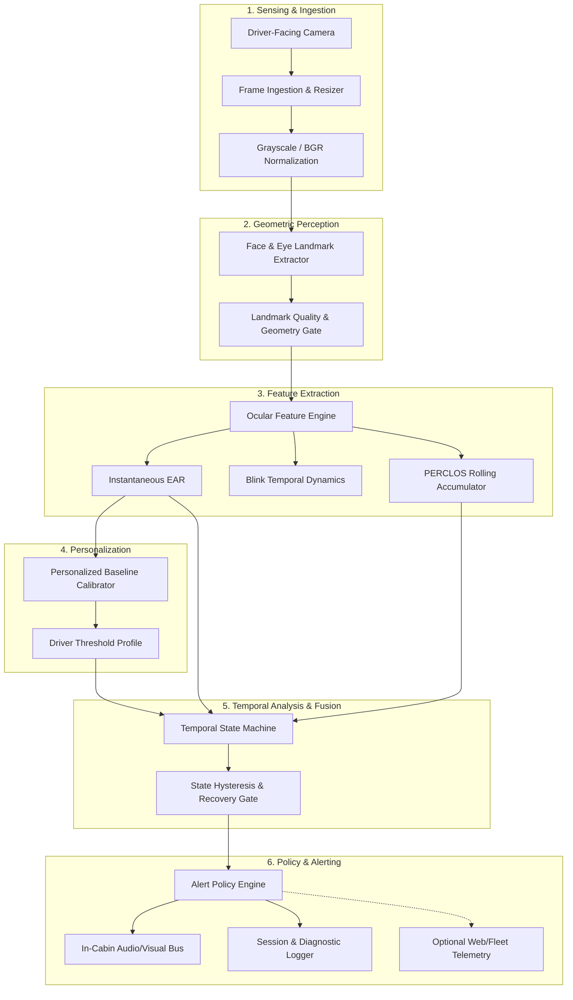

# AntiRHys Product Architecture: Scalable Edge Camera System

## 1. System Vision & Migration Path

AntiRHys is transitioning from an initial **browser-based demonstration prototype** into a **dedicated driver-facing camera system with local edge processing and immediate in-cabin alerts**. The web application and WebSocket bridge serve as an interactive research and evaluation harness, but the target commercial product runs standalone inside the vehicle.

```
+---------------------------------------------------------------------------------------------------+
|                                  IN-VEHICLE EDGE HARDWARE NODE                                    |
|                                                                                                   |
|  +--------------------+     +---------------------------+     +--------------------------------+  |
|  | NIR Optical Sensor | --> | Edge AI SoC / Neural Proc | --> | Low-Latency Local In-Cabin Bus |  |
|  | (Global Shutter)   |     | (Stand-alone Detection)   |     | (Piezo Buzzer & HUD Indicator) |  |
|  +--------------------+     +---------------------------+     +--------------------------------+  |
+-------------------------------------------------------------|-------------------------------------+
                                                              | Optional Diagnostic Telemetry
                                                              v
                                              +----------------------------------+
                                              | Local Web Dashboard / Fleet Tele |
                                              +----------------------------------+
```

### 1.1 Deployment Targets

| Deployment Target | Primary Runtime | Frame Source | Processing Location | Alert Mechanism | Current Status |
| :--- | :--- | :--- | :--- | :--- | :--- |
| **Stage 1: Web Prototype** | Browser (React) + Server (FastAPI) | WebRTC `getUserMedia` (Webcam) | Server CPU (Python / MediaPipe) | Web Audio API + DOM UI | **Implemented & Verified** |
| **Stage 2: Local Station** | Standalone Executable (C++ / Python) | Native V4L2 / DirectShow USB | Local Host CPU/GPU | System Audio / OS Notifications | **Architected (Stage 2)** |
| **Stage 3: Edge Embedded** | Embedded Linux / RTOS (e.g., RK3588, Jetson Orin Nano, Hailo-8) | MIPI-CSI2 Near-IR Sensor | Onboard NPU (Quantized TFLite/ONNX) | Direct GPIO Piezo / CAN Bus Alert | **Target Architecture** |
| **Stage 4: Fleet Telemetry** | Edge Daemon + MQTT/TLS Client | Local Edge Pipeline Results | Onboard Engine | Telemetry summary (Scalar event logs only) | **Planned Research** |

---

## 2. Decoupled Modular Engine Boundaries

The detection engine is architecturally decoupled from web frameworks, WebSockets, and UI layers. The core engine operates strictly on raw image buffers or landmark structures, exposing clean, typed interfaces.



### Boundary 1: Frame Ingestion & Preprocessing
- **Responsibility:** Ingest frames from camera interface (WebRTC canvas in Stage 1, V4L2/MIPI in Stage 3), normalize timestamps using monotonic clock (`time.monotonic()`), resize to nominal processing resolution ($640 \times 480$), and format color spaces.
- **Contract:** Input: raw camera handle; Output: `(frame_buffer: np.ndarray, monotonic_timestamp: float)`.

### Boundary 2: Face & Eye Landmark Extraction
- **Responsibility:** Detect face bounding box and extract 468/478 facial mesh landmarks.
- **Contract:** Input: `frame_buffer`; Output: `LandmarkExtractionResult(has_face: bool, landmarks: List[Point3D], tracking_confidence: float)`.

### Boundary 3: Feature Calculation Engine
- **Responsibility:** Derive mathematical ocular features:
  - Euclidean distance vectors for Eye Aspect Ratio (EAR).
  - Inter-frame ocular velocity and blink duration.
  - Rolling window integration for PERCLOS (Proportion of Eye Closure).
- **Contract:** Input: `LandmarkExtractionResult`; Output: `OcularFeatures(ear_left, ear_right, ear_avg, is_closed, blink_event)`.

### Boundary 4: Driver-Specific Baseline Management
- **Responsibility:** Execute privacy-preserving calibration on consenting driver; measure empirical open-eye distribution; calculate individualized thresholds with safety clamping ($0.18 \le \tau \le 0.32$).
- **Contract:** Input: stream of `OcularFeatures` over 10–15s calibration window; Output: `DriverBaseline(personalized_closure_threshold, is_valid)`.

### Boundary 5: Temporal Behavior Analysis
- **Responsibility:** Evaluate time-series trends independent of frame rate. Maintain state machines for:
  - Tracking state: `ACTIVE`, `LOST`, `SEARCHING`.
  - Acute micro-sleep detection (continuous closure $\ge 1.5\text{s}$).
  - Cumulative drowsiness (PERCLOS $\ge 0.20$ over 60s).
  - Recovery hysteresis (continuous open eyes $\ge 1.0\text{s}$).

### Boundary 6: Drowsiness & Road-Hypnosis Research Models
- **Responsibility:** Modular multi-signal fusion layer combining eye behavior, gaze fixation, and head pose orientation with explicit confidence weights.
- **Contract:** Input: `FusedSensorFeatures`; Output: `HypnosisAssessment(index: float, confidence: float, valid: bool)`.

### Boundary 7: Alert Policy Engine
- **Responsibility:** Map detection states into hierarchical intervention levels:
  - Level 0: Safe / Normal driving.
  - Level 1: Advisory / Inattentive notice (visual indicator).
  - Level 2: Acute Warning (immediate pulsed buzzer, $\approx 85\text{ dBA}$).
  - Level 3: Tracking Lost indicator (amber dash light, prompt to adjust camera/realign driver).

### Boundary 8: Session & Diagnostic Logging
- **Responsibility:** Structured local audit logging (CSV/JSONL) with sanitized floating-point outputs, event sequencing, and zero raw video retention.

### Boundary 9: Optional External Telemetry
- **Responsibility:** Low-bandwidth scalar event transport to fleet or dashboard over secure WebSocket/gRPC. Never transmits raw video by default.

---

## 3. Typed Data Interfaces

All subsystem boundaries communicate via structured, immutable data records:

```python
from dataclasses import dataclass
from enum import Enum
from typing import List, Optional

class SystemState(str, Enum):
    INITIALIZING = "INITIALIZING"
    NORMAL = "NORMAL"
    POSSIBLE_DROWSINESS = "POSSIBLE_DROWSINESS"
    TRACKING_LOST = "TRACKING_LOST"
    UNAVAILABLE = "UNAVAILABLE"

@dataclass(frozen=True)
class FrameMetadata:
    frame_id: int
    capture_timestamp: float   # Monotonic clock (seconds)
    width: int
    height: int
    exposure_time_ms: Optional[float] = None

@dataclass(frozen=True)
class ExtractedOcularFeatures:
    has_face: bool
    tracking_confidence: float
    left_ear: float
    right_ear: float
    average_ear: float
    is_closed: bool
    blink_detected: bool
    blink_duration_sec: float

@dataclass(frozen=True)
class PerclosMetric:
    perclos_value: float       # [0.0, 1.0]
    valid_window_sec: float
    is_valid: bool
    status: str                # VALID, CALCULATING, INSUFFICIENT_DATA

@dataclass(frozen=True)
class DetectionOutput:
    timestamp: float
    system_state: SystemState
    alarm_active: bool
    ear: float
    perclos: float
    closure_duration_sec: float
    blink_count: int
    diagnostic_code: Optional[str] = None
```

---

## 4. Privacy, Security & Edge Autonomy Principles

1. **Zero Raw Video Retention by Default:** Video frames are processed in volatile RAM buffers and immediately discarded post-inference.
2. **Local Edge Autonomy:** Safety-critical detection and auditory alarms MUST operate entirely without internet connectivity. Cloud dependencies in the vehicle cabin are prohibited.
3. **Anonymized Diagnostic Telemetry:** When fleet telemetry is enabled, only scalar time-series (EAR, PERCLOS, state, timestamps) are transmitted over TLS. No biometric face vectors are stored or transmitted.
4. **Consent & Right to Erasure:** Baseline calibration profiles are stored locally in plaintext JSON, allowing drivers to view, reset, or delete their profile at any time.
