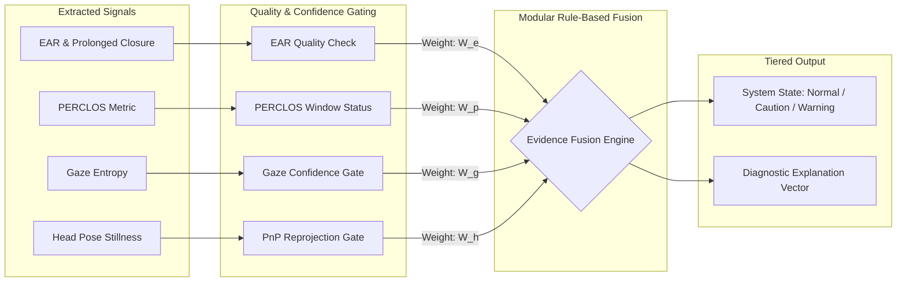

# AntiRHys Multisignal Road Hypnosis & Drowsiness Research Specification

## 1. Executive Summary & Epistemic Boundaries

AntiRHys investigates observable physiological and behavioral cues associated with driver impairment, specifically **acute drowsiness**, **subtle vigilance decrements**, and **road hypnosis (highway hypnosis)**.

> [!CAUTION]
> **Scientific Integrity & Medical Disclaimer:**
> Road hypnosis, driver drowsiness, and driving safety **CANNOT be definitively diagnosed from computer vision alone**. Facial landmarks, Eye Aspect Ratio (EAR), gaze patterns, and head orientations are observational proxies. Normal drivers periodically exhibit fixed gazes, long blinks, or steady head poses during normal driving without impairment. AntiRHys explicitly rejects claiming "certified safety monitoring" or "automated medical diagnosis." Unvalidated hypnosis scores MUST NOT be displayed in the live dashboard as authoritative assessments.

---

## 2. Theoretical Distinction: Drowsiness vs. Road Hypnosis

| Attribute | Acute Drowsiness / Fatigue | Road Hypnosis (Highway Hypnosis) |
| :--- | :--- | :--- |
| **Cognitive State** | Physical sleep pressure, extreme tiredness, micro-sleep propensity. | Trance-like state of cognitive absorption/dissociation caused by monotonous road conditions; eyes remain open. |
| **Ocular Presentation** | Progressive eyelid drooping, slow eye closures, elevated PERCLOS, frequent long blinks. | Eyelids remain open; fixed gaze ("glassy stare"); dramatic suppression of saccadic visual scanning. |
| **Head Movement** | Nodding off (sudden drops in pitch angle followed by startle recovery). | Unusually static, rigid head posture along the line of sight for extended durations. |
| **Detection Difficulty** | Detectable using standard visible-spectrum webcam via EAR and PERCLOS. | High false-positive risk; requires joint gaze-zone entropy, head-pose stillness, and personalized baseline. |

---

## 3. Candidate Signals: In-Depth Evaluation

### A. Eye Behavior

#### A.1 Eye Aspect Ratio (EAR) & Prolonged Eye Closure
- **What it measures:** Ratio of vertical eye aperture to horizontal eye span from 6 discrete eye landmarks.
- **Relation to objective:** Direct physical indicator of eyelid position; detects acute micro-sleeps ($\ge 1.5\text{s}$ closure).
- **Required camera:** Standard 720p/1080p RGB webcam or Near-IR (NIR) camera; $\ge 10\text{ FPS}$.
- **Known confounders:** Squinting due to sun glare, laughter, ethnic anatomical variations in natural eye aperture, looking down with eyes open, thick eyewear frames.
- **Computational cost:** Extremely low ($< 0.1\text{ ms}$ on modern CPU).
- **Confidence/quality checks:** Minimum horizontal eye span ($> 1\text{ px}$); landmark Euclidean coordinate finite-check.
- **Labelled data testing:** Synthetic sequence benchmarks, public datasets (RLDD, NTHU-DDD, YawDD).
- **Status:** **Implemented & Verified** in core engine.

#### A.2 Blink Dynamics (Frequency, Duration, Velocity)
- **What it measures:** Frequency (blinks/min), closing/reopening duration, and ratio of closing velocity to reopening velocity.
- **Relation to objective:** Attentive drivers blink 12–20 times/min (durations 100–350 ms). Impairment causes elevated blink duration ($> 400\text{ ms}$) or erratic flutter. Road hypnosis can induce reduced blink frequency during staring episodes.
- **Required camera:** High frame rate ($\ge 30\text{ FPS}$, ideally $\ge 60\text{ FPS}$) to resolve blink dynamics without temporal aliasing.
- **Known confounders:** Dry eye syndrome, air conditioning drafts, contact lenses.
- **Computational cost:** Very low ($< 0.2\text{ ms}$).
- **Confidence/quality checks:** Minimum frame rate check; monotonic timestamp validation.
- **Labelled data testing:** High-speed video datasets with frame-by-frame blink onset/offset annotations.
- **Status:** Basic blink count & duration **Implemented & Verified**; high-speed velocity curve **Planned Research** (limited by 10 FPS webcam rate).

#### A.3 PERCLOS (Percentage of Eye Closure)
- **What it measures:** Cumulative proportion of valid observation time that eyes remain closed ($\ge 70\%$ or $80\%$ closed) over a rolling 60-second window.
- **Operational definition in AntiRHys:**
  $$\text{PERCLOS} = \frac{\sum_{\Delta t \in \mathcal{W}_{\text{valid}}} \mathbb{I}(\text{EAR}(t) < \tau_{\text{closure}}) \cdot \Delta t}{\sum_{\Delta t \in \mathcal{W}_{\text{valid}}} \Delta t}$$
  where $\mathcal{W}_{\text{valid}}$ is a 60-second rolling window requiring $\ge 20\text{s}$ of valid face-tracking observations.
- **Relation to objective:** Gold standard research metric validated by Federal Highway Administration (FHWA) for slow-onset cumulative fatigue.
- **Required camera:** Standard camera ($\ge 10\text{ FPS}$).
- **Known confounders:** Frequent looking down at dashboard instruments; tracking dropouts; calibration errors.
- **Computational cost:** Very low ($< 0.05\text{ ms}$ via rolling `deque` integration).
- **Confidence/quality checks:** Explicit status indicators: `VALID`, `CALCULATING` ($< 20\text{s}$ valid data), `INSUFFICIENT_DATA` ($< 20\text{s}$ observed in window), `UNAVAILABLE` (no face).
- **Labelled data testing:** Deterministic unit tests with synthesized irregular frame feeds and tracking dropouts.
- **Status:** **Implemented & Verified**.

---

### B. Gaze and Visual Scanning

#### B.1 Gaze Direction & Gaze-Zone Transitions
- **What it measures:** Vector of driver visual attention relative to vehicle forward axis; classification into discrete zones (Windshield Center, Left Mirror, Right Mirror, Rearview Mirror, Instrument Cluster, Off-Road/Infotainment).
- **Relation to objective:** Active drivers routinely scan between road and mirrors every 5–8 seconds. Road hypnosis exhibits extreme fixation on the center zone with zero mirror checks.
- **Required camera:** High-resolution sensor ($\ge 1080\text{p}$) with calibrated intrinsic matrix and stable iris/pupil landmark detection.
- **Known confounders:** Eye rotation within socket without head movement; astigmatism glasses; variable sun reflections.
- **Computational cost:** Moderate ($2\text{--}5\text{ ms}$ on CPU).
- **Confidence/quality checks:** Iris landmark detection confidence; head pose consistency; illumination uniformity.
- **Labelled data testing:** MPIIGaze, Columbia Gaze, or in-cabin eye-tracking simulator benchmarks.
- **Status:** **Planned Research** (Architecture specified; not yet integrated into production pipeline).

#### B.2 Gaze Entropy & Scanpath Variation
- **What it measures:** Shannon entropy of gaze-zone transitions over a rolling 30–60 second window.
- **Relation to objective:** Quantifies vigilance collapse. Abnormally low entropy indicates road hypnosis (tunnel vision stare); erratic high entropy indicates severe distraction.
- **Required camera:** Same as Gaze Direction.
- **Known confounders:** Long straight desert highway driving naturally requires fewer mirror checks; heavy traffic increases scanning.
- **Computational cost:** Low ($< 0.5\text{ ms}$).
- **Confidence/quality checks:** Minimum valid gaze sample ratio in rolling window.
- **Labelled data testing:** Naturalistic driving study datasets with cognitive task labeling.
- **Status:** **Planned Research**.

---

### C. Head Behavior

#### C.1 3D Head Pose (Pitch, Yaw, Roll)
- **What it measures:** 3D rotational angles of driver skull estimated via Perspective-n-Point (PnP) using canonical 3D anthropometric facial landmarks (`[1, 152, 263, 33, 291, 61]`).
- **Angle and Sign Conventions:**
  - Pitch: Rotation around $X$-axis. Negative ($< 0^\circ$) = head tilted down / chin toward chest (nodding); Positive ($> 0^\circ$) = head tilted up.
  - Yaw: Rotation around $Y$-axis. Negative ($< 0^\circ$) = driver turning right; Positive ($> 0^\circ$) = driver turning left.
  - Roll: Rotation around $Z$-axis. Negative ($< 0^\circ$) = counter-clockwise tilt; Positive ($> 0^\circ$) = clockwise tilt.
- **Relation to objective:**
  - Micro-sleep nod: sudden negative pitch (chin drops toward chest).
  - Distraction: persistent yaw ($> 20^\circ$) away from roadway.
  - Road hypnosis: unnatural lack of head movement variance over extended driving periods.
- **Signal Isolation & Safety:** Strictly observational telemetry. Does NOT trigger drowsiness alarms or override EAR/PERCLOS metrics.
- **Required camera:** Standard camera; pinhole camera intrinsic matrix approximated from frame dimensions ($f_x = f_y = W, c_x = W/2, c_y = H/2$).
- **Known confounders:** Camera mounting offset (camera placed on A-pillar or dashboard angle instead of steering column); driver slouching; bumpy road vibration.
- **Computational cost:** Low (~$2.5\text{ ms}$ with OpenCV `solvePnP` iterative + `RQDecomp3x3` on CPU).
- **Confidence/quality checks:** Pre-validation (finite coordinates, minimum 15px bounding box span); PnP reprojection RMSE gating ($< 15.0\text{ px}$).
- **Labelled data testing:** Unit test suite with canonical poses and pitch/yaw/roll rotations; BIWI Kinect Head Pose Database.
- **Status:** **Implemented & Verified (Observational Telemetry)** in `backend/head_pose.py`.

---

### D. Pupil-Related Features

#### D.1 Pupil Diameter & Pupillometry Dynamics
- **What it measures:** Metric pupil aperture and Pupillary Unrest Index (PUI) measuring autonomic nervous system oscillations.
- **Relation to objective:** Fatigue alters sympathetic/parasympathetic tone, causing pupillary oscillations and constriction.
- **Required camera & hardware:** **CRITICAL CONSTRAINT:** Standard RGB webcams CANNOT reliably measure pupil diameter in a moving vehicle. Real pupillometry requires:
  1. Synchronized active Near-Infrared (NIR) illumination (850 nm or 940 nm) to avoid visible glare and eliminate ambient sunlight variations.
  2. Global-shutter optical sensor to prevent rolling-shutter distortion during motion.
  3. High optical resolution focused on ocular region ($\ge 40\text{ pixels}$ across the iris).
- **Known confounders:** Ambient sunlight changes, streetlights at night, optical reflections on eyeglasses, pharmacological agents, tinted sunglasses.
- **Computational cost:** Moderate-to-high (ellipse fitting on thresholded infrared reflections).
- **Confidence/quality checks:** Pupil contrast ratio, circularity metric, ambient lux sensor input.
- **Status:** **Blocked on Hardware** (Documented as future hardware requirement; prohibited on consumer webcams to prevent deceptive claims).

---

## 4. Signal Feasibility & Implementation Matrix

| Signal Group | Specific Feature | Hardware Prerequisite | Implementation Status | Safety/Diagnostic Claim Level |
| :--- | :--- | :--- | :--- | :--- |
| **Eye** | Instantaneous EAR | Standard RGB Webcam | **Implemented & Verified** | Provisional Observation |
| **Eye** | Prolonged Closure | Standard RGB Webcam | **Implemented & Verified** | Suspected Acute Drowsiness |
| **Eye** | PERCLOS (60s window) | Standard RGB Webcam | **Implemented & Verified** | Validated Fatigue Metric |
| **Eye** | Blink Frequency/Duration | Standard RGB Webcam | **Implemented & Verified** | Secondary Indicator |
| **Gaze** | 3D Gaze Direction | High-Res NIR / Calibrated RGB | **Planned Research** | Distraction / Attention Vector |
| **Gaze** | Gaze-Zone Entropy | High-Res NIR / Calibrated RGB | **Planned Research** | Hypnosis Research Proxy |
| **Head** | 3D Head Pose (PnP) | Standard RGB / NIR | **Proposed (Stage 2)** | Posture / Micro-Nod Proxy |
| **Pupil** | Pupil Diameter / PUI | Global Shutter + Active NIR | **Blocked on Hardware** | Medical / Neurological Research Only |

---

## 5. Modular Feature-Fusion Architecture

Rather than computing a naive weighted average that silently treats missing signals as zero, AntiRHys specifies a **Gated Evidence Fusion Model**:

### Fusion Rules:
1. **Never Zero Missing Signals:** If gaze estimation is unavailable or untracked, $W_{\text{gaze}} = 0$ and weights are renormalized across available high-confidence modalities.
2. **Acute Override:** A prolonged eye closure ($\ge 1.5\text{s}$) triggers immediate `POSSIBLE_DROWSINESS` regardless of gaze or head scores.
3. **Hypnosis Hypothesis Trigger:** Road hypnosis is only flagged as a research observation when:
   - Head pose variance is abnormally low ($< 1.0^\circ$ standard deviation over 30s), AND
   - Gaze entropy is abnormally low (fixation on center $> 90\%$ without mirror checks), AND
   - PERCLOS is normal (eyes are open, ruling out classic micro-sleep), AND
   - Individual baseline calibration is active and valid.
